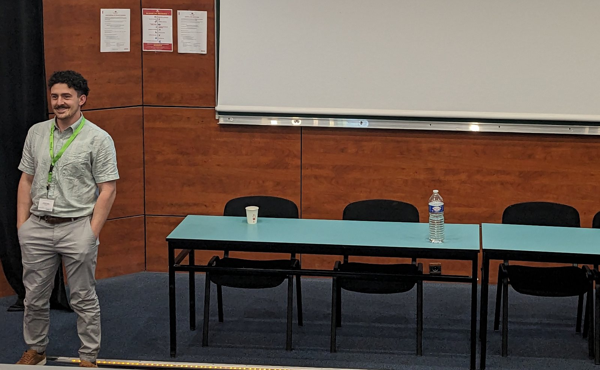
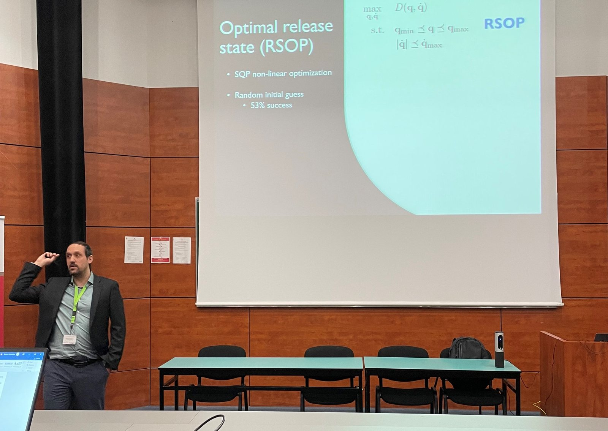
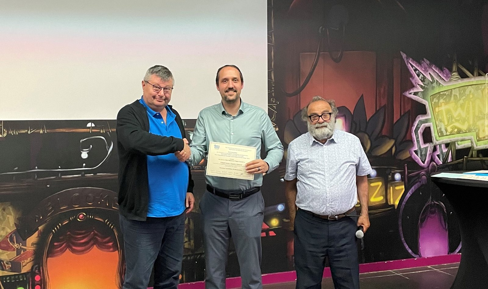

Dynamium a présenté deux articles à MeTrApp 2023, la conférence Mechanisms, Transmissions and Applications. L'un d'eux a reçu le prix de bronze de la conférence.

### Augmenter la charge utile d'un cobot à 7 degrés de liberté

Le premier article, *Increasing the Payload of a 7DOF Cobot*, traite de deux limites des robots collaboratifs : leur faible charge utile et la génération de trajectoires en temps réel dans des environnements encombrés. Il propose une méthode d'optimisation de trajectoire fondée sur des B-splines d'ordre cinq.

Appliquée en simulation à un manipulateur collaboratif Kinova Gen3 à 7 degrés de liberté, la méthode fait passer la charge utile de 4 kg à 8 kg sur six tâches de prise dans un bac, dans la zone intermédiaire de l'espace de travail. L'article compare 35 configurations d'optimisation pour trouver les meilleurs réglages en temps minimal avec la charge ajoutée. Les meilleures configurations atteignent des solutions quasi optimales avec un taux de réussite de 100 % et un temps de calcul moyen de 43,3 ms. Certains cas réussissent avec des charges allant jusqu'à 14 kg.

### Capacités de lancer des manipulateurs (prix de bronze)

Le second article intègre la capacité de lancer des objets à la conception cinématique d'un manipulateur. Il formule trois problèmes d'optimisation : maximiser la distance de lancer à l'état de relâchement, concevoir des trajectoires sous contraintes de position, de vitesse, d'accélération et de saccade, et optimiser la conception cinématique pour étendre à la fois l'espace de travail et la distance de lancer.

Des études de cas sur des manipulateurs RR plan, RRR spatial et 6R à poignet découplé montrent que le lancer peut être pris en compte dès la conception, et donnent un moyen de vérifier si une tâche de lancer donnée est réalisable par un manipulateur donné.

