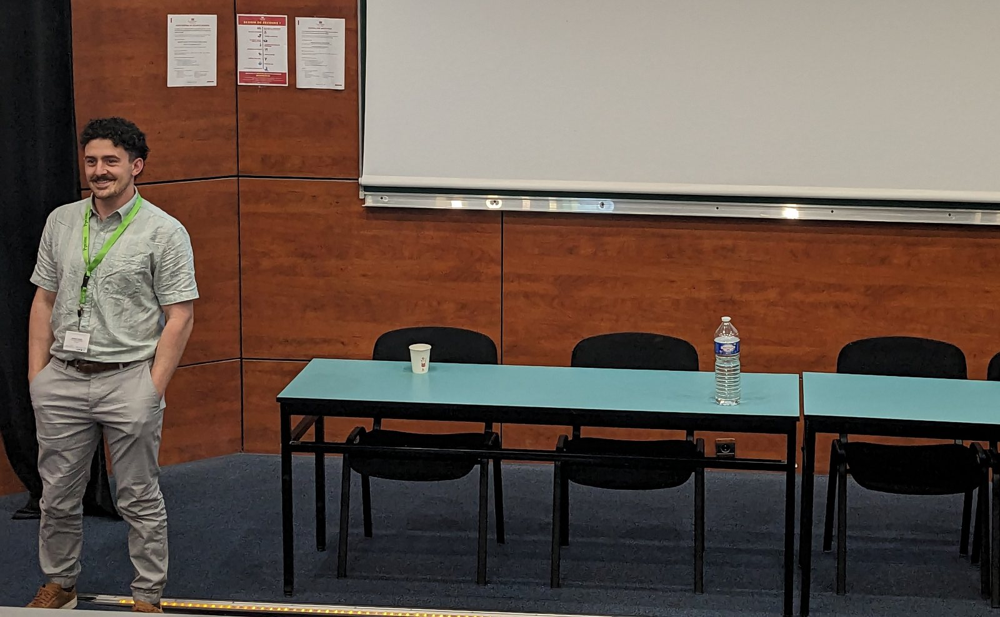
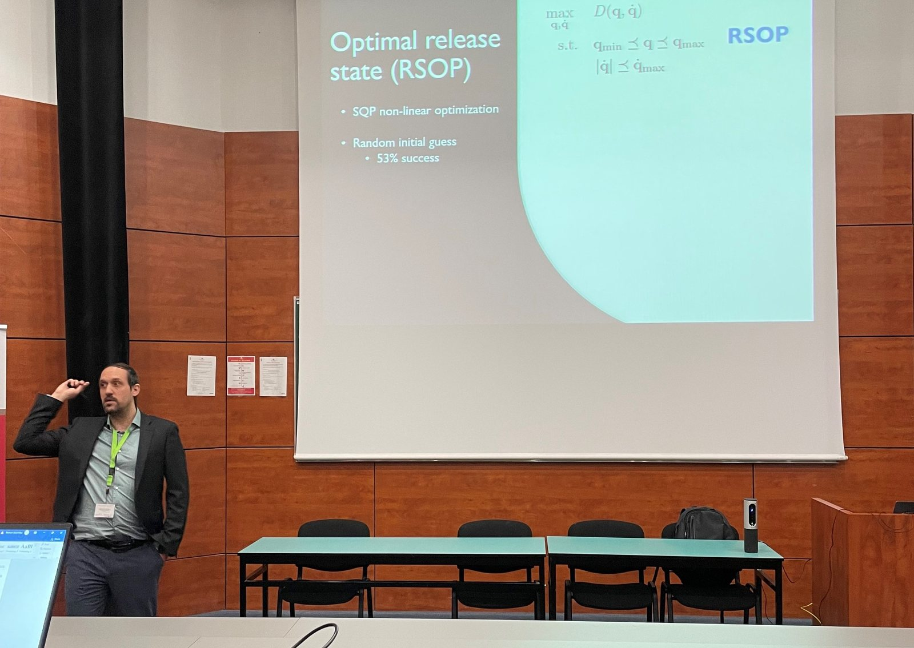

Dynamium presented two papers at MeTrApp 2023, the conference on Mechanisms, Transmissions and Applications. One of them received the conference's Bronze Prize.

### Increasing the payload of a 7-DOF cobot

The first paper, *Increasing the Payload of a 7DOF Cobot*, addresses two limits of collaborative robots: low payload capacity and real-time trajectory generation in cluttered environments. It proposes a trajectory optimization method based on fifth-order B-splines.

Applied in simulation to a Kinova Gen3 7-DOF collaborative manipulator, the method raises the payload from 4 kg to 8 kg over six bin-picking tasks in the robot's mid-range workspace. The paper compares 35 optimization configurations to find the best settings for time-optimal motion with the added payload. The best configurations reach near-optimal solutions with a 100% success rate and an average computation time of 43.3 ms. Some cases succeed with payloads up to 14 kg.

### Throwing capabilities of manipulators (Bronze Prize)

The second paper includes the ability to throw objects in the kinematic design of a manipulator. It formulates three optimization problems: maximizing the throwing distance at the release state, designing trajectories under position, velocity, acceleration and jerk constraints, and optimizing the kinematic design to extend both the workspace and the throwing distance.

Case studies on planar RR, spatial RRR and wrist-partitioned 6R manipulators show that throwing can be taken into account at the design stage, and give a way to check whether a given throwing task is feasible for a given manipulator.

