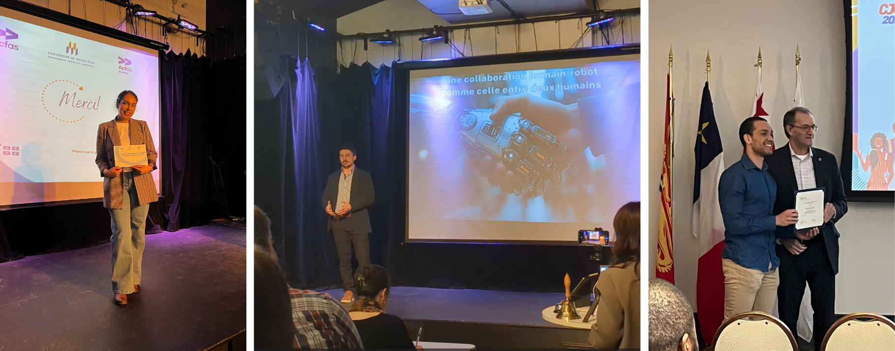

This spring, three members of the lab received awards for presenting their research at two student research events: *Ma thèse en 180 secondes* (MT180) and the *Colloque des jeunes chercheures et chercheurs* (CJCC).

- **Ghali Kabbaj** won first prize in the undergraduate category at the CJCC for *Improving the Accuracy of a Robotic Arm Model Using a Hybrid AI-Physics Approach*. The project combines a physical model of the arm with a learned correction to predict its dynamics more accurately.
- **Nikos Doiron** won second prize in the doctoral category at MT180 for *A Human-Robot Collaboration Like That Between Two Humans*, which presents his thesis work on making physical collaboration with a robot as natural as working with a colleague.
- **Meriem Haddaji Mastouri** received the audience award for *Fast Robotics: Harnessing GPU Power to Optimize Trajectories*, on the parallel computation of manipulator trajectories on graphics processors.

Congratulations to Ghali, Nikos and Meriem.
