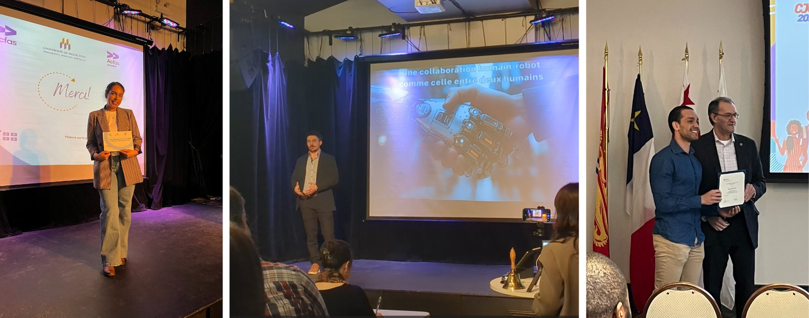

Ce printemps, trois membres du laboratoire ont été primés pour la présentation de leurs travaux lors de deux événements de recherche étudiante : *Ma thèse en 180 secondes* (MT180) et le *Colloque des jeunes chercheures et chercheurs* (CJCC).

- **Ghali Kabbaj** a remporté le premier prix de la catégorie premier cycle au CJCC avec *Amélioration de la précision d'un modèle de bras robotisé en utilisant une approche hybride IA-physique*. Le projet combine un modèle physique du bras et une correction apprise pour mieux prédire sa dynamique.
- **Nikos Doiron** a obtenu le deuxième prix de la catégorie doctorat à MT180 avec *Une collaboration humain-robot comme celle entre deux humains*, qui présente sa thèse sur une collaboration physique avec un robot aussi naturelle qu'avec un collègue.
- **Meriem Haddaji Mastouri** a reçu le prix coup de cœur du public avec *Robotique rapide : exploiter la puissance des cartes graphiques pour optimiser les trajectoires*, sur le calcul parallèle des trajectoires de manipulateurs sur processeur graphique.

Félicitations à Ghali, Nikos et Meriem.
