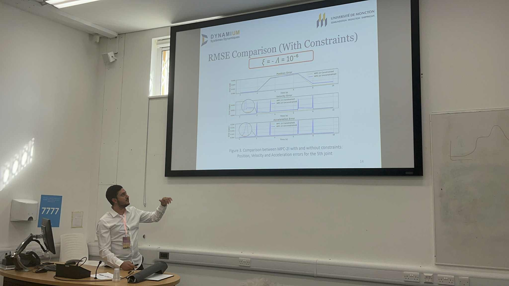

Cet été, Sedki Limam a présenté l'article *Decoupled MPC with Constrained Optimization for Enhanced Robot Manipulator Trajectory Tracking* à l'IEEE International Conference on Advanced Robotics and Mechatronics (ICARM 2025), tenue à l'Université de Portsmouth, au Royaume-Uni.

L'article s'inscrit dans la maîtrise de Sedki à l'Université de Moncton. Il propose une architecture de commande prédictive par modèle (MPC) découplée, combinée à une optimisation sous contraintes résolue en temps réel, pour améliorer le suivi de trajectoire des manipulateurs robotiques. L'objectif est un mouvement plus lisse et un suivi plus stable de la trajectoire de référence.

La présentation a eu lieu dans la séance *Intelligent Mechatronics, Automation, Control Systems & Rehabilitation Robot System, Neuro-Robotics, Wearable Robots*.

Ces travaux ont été financés par la Fondation de l'innovation du Nouveau-Brunswick (FINB) et l'Agence de promotion économique du Canada atlantique (APECA).
