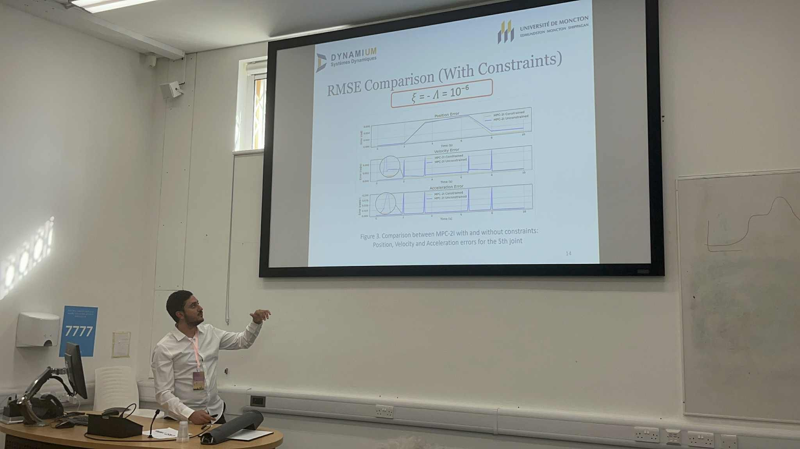

This summer, Sedki Limam presented the paper *Decoupled MPC with Constrained Optimization for Enhanced Robot Manipulator Trajectory Tracking* at the IEEE International Conference on Advanced Robotics and Mechatronics (ICARM 2025), held at the University of Portsmouth, United Kingdom.

The paper is part of Sedki's master's research at Université de Moncton. It proposes a decoupled model predictive control (MPC) architecture, combined with constrained optimization solved in real time, to improve trajectory tracking on robot manipulators. The goal is smoother motion and more stable tracking of the reference trajectory.

The talk was given in the session *Intelligent Mechatronics, Automation, Control Systems & Rehabilitation Robot System, Neuro-Robotics, Wearable Robots*.

This research was funded by the New Brunswick Innovation Foundation (NBIF) and the Atlantic Canada Opportunities Agency (ACOA).
